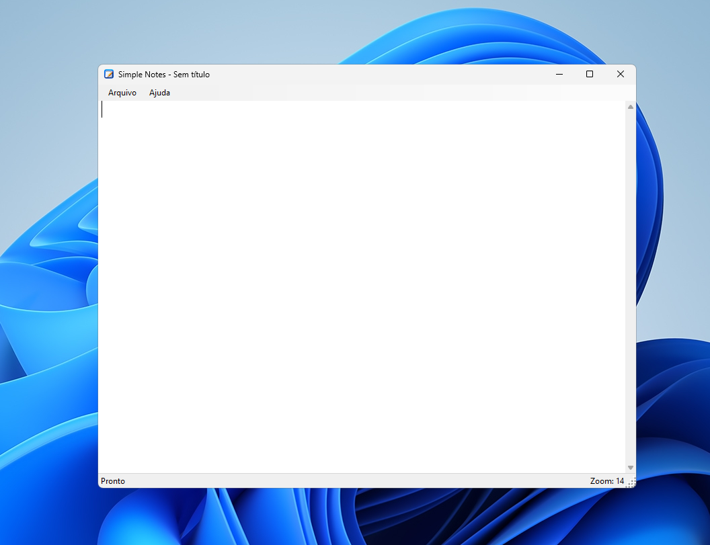

# SimpleNotes

<p align="center">
  
</p>

<h3 align="center">Um editor de texto simples, leve e integrado ao Windows.</h3>

<p align="center">
  Desenvolvido em C# com Windows Forms e .NET 10.
</p>

<p align="center">
  
  
  
  
  
</p>

---

## Visão geral

O **SimpleNotes** é um editor de texto para Windows desenvolvido com C#, Windows Forms e .NET 10.

O projeto tem como objetivo oferecer uma experiência simples e direta para criação, edição e gerenciamento de arquivos de texto, priorizando facilidade de uso, integração com o sistema operacional e funcionalidades essenciais para o trabalho com documentos.

## Capturas de tela

<p align="center">
  
</p>

<p align="center">
  <i>Interface do aplicativo SimpleNotes.</i>
</p>

> Para exibir a captura de tela, adicione uma imagem da interface com o nome `screenshot.png` dentro da pasta `Assets`.

## Funcionalidades

- **Gerenciamento de documentos**
  - Criar novos documentos.
  - Abrir arquivos existentes.
  - Salvar documentos.
  - Salvar como, permitindo escolher outro nome ou diretório.

- **Edição e usabilidade**
  - Identificação de alterações não salvas.
  - Confirmação antes de descartar alterações.
  - Controle de zoom com `Ctrl + roda do mouse`.

- **Atalhos de teclado**

  | Atalho | Ação |
  |:---|:---|
  | `Ctrl + N` | Novo documento |
  | `Ctrl + O` | Abrir arquivo |
  | `Ctrl + S` | Salvar |
  | `Ctrl + Shift + S` | Salvar como |
  | `Esc` | Sair da aplicação |

- **Integração com o Windows**
  - Abertura de arquivos por argumentos de linha de comando.
  - Integração com o menu de contexto.
  - Registro do aplicativo no Windows.
  - Associação de arquivos configurável pelo sistema.
  - Instalador e desinstalador próprios.

## Tecnologias utilizadas

| Tecnologia | Aplicação |
|:---|:---|
| C# | Linguagem de programação |
| .NET 10 | Plataforma de desenvolvimento |
| Windows Forms | Interface gráfica |
| Inno Setup | Criação do instalador |

## Estrutura do projeto

```text
SimpleNotes/
│
├── Assets/
│   └── icone.ico
│
├── Installer/
│   └── SimpleNotes.iss
│
├── Models/
│   └── Document.cs
│
├── Services/
│   ├── DocumentService.cs
│   └── FileService.cs
│
├── utils/
│   └── FileOperations.cs
│
├── Program.cs
├── MainForm.cs
├── MainForm.Designer.cs
├── AboutForm.cs
├── AboutForm.Designer.cs
├── SimpleNotes.csproj
├── LICENSE
└── README.md
```

## Requisitos para desenvolvimento

- Windows 10 ou Windows 11.
- Visual Studio com suporte ao desenvolvimento desktop com .NET.
- .NET 10 SDK.
- Inno Setup para gerar o instalador.

## Instalação e execução

### 1. Clonar o repositório

```bash
git clone https://github.com/hiagosso/SimpleNotesApp.git
```

### 2. Acessar o diretório

```bash
cd SimpleNotesApp
```

### 3. Executar o projeto

```bash
dotnet run
```

## Abrir arquivos pela linha de comando

O SimpleNotes permite receber caminhos de arquivos como argumentos de linha de comando.

Utilizando o ambiente de desenvolvimento:

```powershell
dotnet run -- "C:\Documentos\anotacoes.txt"
```

Executando diretamente o aplicativo:

```powershell
SimpleNotes.exe "C:\Documentos\anotacoes.txt"
```

Esse mecanismo permite que o Windows encaminhe arquivos ao aplicativo por meio do menu de contexto e das associações configuradas no sistema.

## Publicação

Para gerar uma versão Release independente de runtime para Windows 64 bits, execute:

```powershell
dotnet publish .\SimpleNotes.csproj -c Release -r win-x64 --self-contained true
```

Os arquivos publicados serão gerados em:

```text
bin/Release/net10.0-windows/win-x64/publish/
```

A publicação `self-contained` inclui o runtime necessário para executar o aplicativo, dispensando a instalação separada do runtime do .NET 10 pelo usuário.

## Gerar o instalador

O projeto utiliza o **Inno Setup** para empacotar os arquivos publicados e gerar o instalador do aplicativo.

Etapas:

1. Gere a publicação em configuração Release.
2. Abra `Installer/SimpleNotes.iss` no Inno Setup.
3. Confira o caminho configurado em `PublishDir`.
4. Compile o script.
5. Localize o instalador gerado na pasta `InstallerOutput`.

### Recursos do instalador

- Configuração do diretório de instalação.
- Criação de atalho no menu Iniciar.
- Atalho opcional na área de trabalho.
- Registro do aplicativo no Windows.
- Opção de abertura de arquivos pelo menu de contexto.
- Desinstalação do aplicativo.

## Integração com o Windows

O instalador registra o SimpleNotes no Windows e disponibiliza uma opção para abrir arquivos por meio do menu de contexto.

A definição do SimpleNotes como aplicativo padrão permanece sob controle do usuário, por meio das configurações do próprio Windows.

> **Observação:** O SimpleNotes é um editor de texto simples. Embora possa receber arquivos com diferentes extensões, arquivos binários e formatos estruturados, como imagens, executáveis e documentos do Word, não são interpretados como em seus aplicativos especializados.
>
> A posição dos comandos no menu de contexto também pode variar conforme a versão do Windows.

## Git e versionamento

Os arquivos de código-fonte, configurações e scripts do instalador devem ser versionados.

Pastas e arquivos gerados durante a compilação e publicação não devem ser enviados ao repositório.

Exemplos de diretórios que devem ser ignorados:

```gitignore
bin/
obj/
.vs/
publish/
InstallerOutput/
```

## Licença

Este projeto está licenciado sob a **GNU General Public License v3.0 (GPL-3.0)**.

Você pode utilizar, estudar, modificar e redistribuir este software, desde que respeite os termos estabelecidos pela licença.

Consulte o arquivo [LICENSE](LICENSE) para obter o texto completo.

---

<p align="center">
  Desenvolvido como projeto de aprendizado e prática de desenvolvimento desktop com C#, Windows Forms e .NET 10.
</p>

<p align="center">
  <b>SimpleNotes</b> · Desenvolvido por <a href="https://github.com/hiagosso">Hiago</a>
</p>